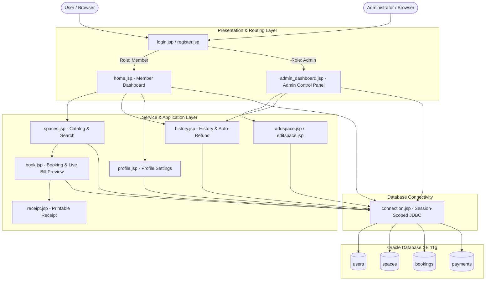

# Coworking Space Booking System

A full-stack web application designed for dynamic workspace management and reservations, built using **Java Server Pages (JSP)** running on **Apache Tomcat 10** and connected to **Oracle Database XE 11g** via JDBC.

Developed for the **System Design and Analysis** course at **University of Scholars**.

---

## 🏛️ System Architecture

---

## 🌟 Key Features

### 👤 Member Portal
- **Unified Role-Based Authentication:** Single login automatically directs members to the dashboard and admins to the management control panel.
- **Member Dashboard:** Real-time personal statistics cards (*Available Workspaces*, *My Active Bookings*, *My Total Spent ($)*) and an upcoming reservation schedule table.
- **Profile & Credentials Management:** Members can view and update their personal details and account password (`UPDATE users`).
- **Interactive Space Catalog:** Browse dedicated desks, private office cabins, and conference rooms with keyword search and category filter pills (*Desks*, *Private Cabins*, *Meeting Rooms*).
- **Intelligent Slot Reservation:**
  - Automatic blocking of past calendar dates.
  - Live duration and billing preview calculator.
  - Upcoming Reserved Slots table displaying taken hours for each room before booking.
  - SQL-level overlap detection to prevent double-booking.
- **Official Printable Receipts:** Dedicated printable invoice (`receipt.jsp`) with one-click print support (`window.print()`).
- **Booking History & Auto-Refund:** View reservations with status filter pills (*All*, *Confirmed*, *Cancelled*). Cancelling automatically updates payment status to **Refunded**.

### 🛠️ Administrator Control Panel
- **Analytics Overview:** 4 top KPI cards (*Total Workspaces*, *Registered Accounts*, *Confirmed Bookings*, *Confirmed Revenue ($)*).
- **Workspace Inventory Management:** Add, edit, and delete workspace listings with foreign-key cascade deletion safety and live action banners.
- **Reservations Hub:** Monitor system-wide member bookings, filter by status, and cancel reservations with automated payment refund processing.
- **Registered Members Directory:** Comprehensive directory showing all registered user accounts, roles, total reservations count, and confirmed spend.

---

## 🏗️ Technology Stack

| Layer | Technology |
|---|---|
| **Frontend** | HTML5, Modern SaaS CSS3 (Inter Typography, Print Media Layouts) |
| **Backend** | Java Server Pages (JSP Scriptlets) |
| **Web Server** | Apache Tomcat 10.1.28 |
| **Database** | Oracle Database XE 11.2 |
| **Connectivity** | Oracle JDBC Thin Driver (`ojdbc6.jar` / `ojdbc8.jar`) with session-scoped connection caching |
| **IDE** | Apache NetBeans |
| **CI/CD** | GitHub Actions Automated Build & Syntax Validation |

---

## 🗄️ Relational Database Schema

The database consists of 4 normalized relational tables managed via Oracle sequences:

1. **`users`** (`user_id` [PK], `name`, `email`, `password`, `phone`, `role`)
2. **`spaces`** (`space_id` [PK], `title`, `space_type`, `capacity`, `hourly_rate`, `location_floor`, `description`)
3. **`bookings`** (`booking_id` [PK], `user_id` [FK], `space_id` [FK], `booking_date`, `start_time`, `end_time`, `hours`, `total_amount`, `status`)
4. **`payments`** (`payment_id` [PK], `booking_id` [FK], `payment_method`, `amount`, `status`)

*Standalone setup, seed, and reset SQL scripts are available in the [`db/`](./db/) directory.*

---

## 🚀 Setup & Execution

1. **Prerequisites:**
   - Java Development Kit (JDK 8 or higher)
   - Apache Tomcat 10+
   - Oracle Database Express Edition (XE) 11g+
   - Apache NetBeans IDE
2. **Database Setup:**
   - Execute [`db/01_schema.sql`](./db/01_schema.sql) and [`db/02_seed.sql`](./db/02_seed.sql) in Oracle SQL Commands / SQL*Plus, or allow `connection.jsp` to auto-seed tables upon first application run.
3. **Deploy & Run:**
   - Open the project in NetBeans.
   - Configure Tomcat 10 server runtime.
   - Build and run (`http://localhost:8088/CoworkingSpaceBookingSystem/`).

---

## 📜 License

This project is open-source and distributed under the [MIT License](./LICENSE).

---

## 👤 Author

- **Sadman Fahmid Raj**
- University of Scholars
